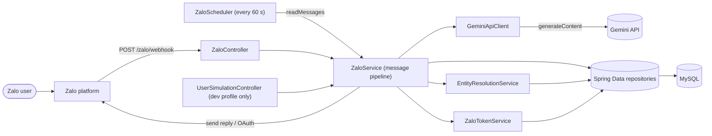
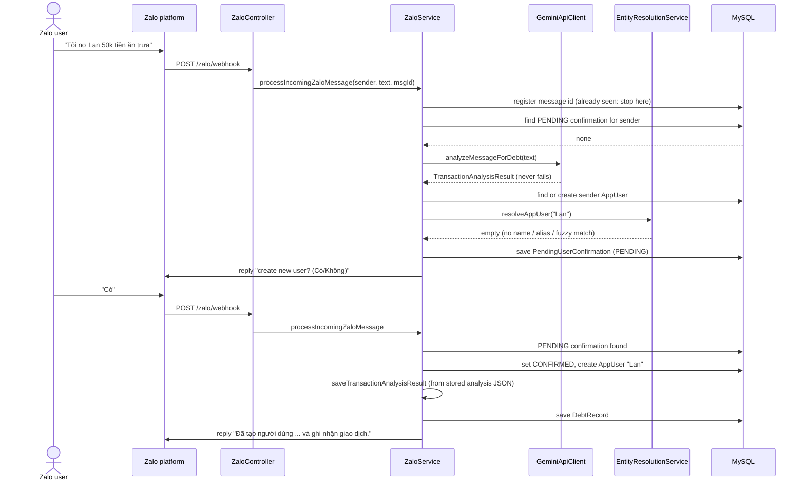
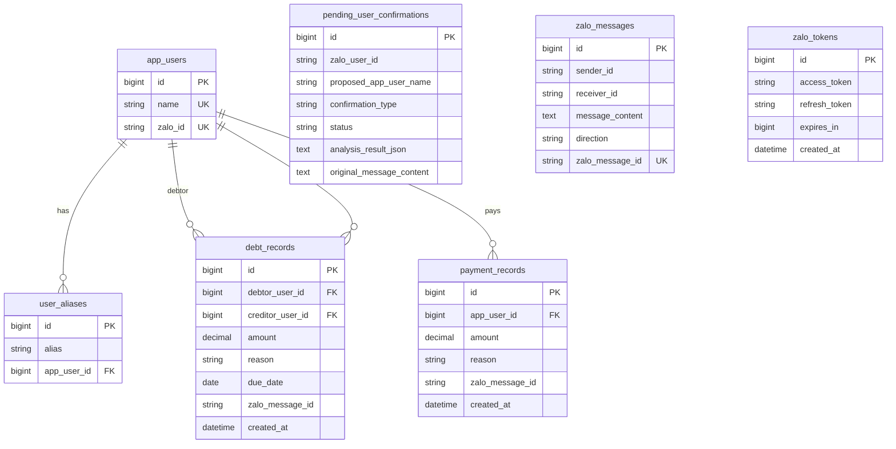

# Zalo Debt Bot


A Spring Boot backend for a **Zalo Official Account** that turns informal chat messages such as
*"Tôi nợ Lan 50k tiền ăn trưa"* ("I owe Lan 50k for lunch") into structured debt and payment records. It uses the
**Google Gemini API** to understand the message and a small confirmation dialogue to avoid recording the wrong person.

> **Status: work in progress / portfolio project.** The path from an inbound message to a stored record,
> including the "create this person?" confirmation, is implemented and unit-tested with mocked
> external services. It has not been run against a production Zalo OA, and it has no users.
> See [Trade-offs and known limitations](#trade-offs-and-known-limitations).

## What problem it solves

Small shops and friend groups in Vietnam often track "who owes whom" in a Zalo chat: *"Lan owes me 50k for lunch"*,
*"I paid Minh back"*. Those messages are free text, in Vietnamese, with shorthand amounts (`50k`), and nobody ever
adds them up. This service listens to the chat of an Official Account, asks an LLM to extract the transaction
(who, how much, which direction, why), resolves the person's name against known people (exact, alias, fuzzy),
asks the sender to confirm when the person is new, and stores the result in MySQL so it can be queried and summed.

## Example

Illustrative flow. The Vietnamese replies are the literal strings in `ZaloService`; the extracted JSON is what the
prompt in `GeminiApiClient` asks Gemini for (the model output itself is not deterministic).

| # | Who | Message |
|---|-----|---------|
| 1 | User | `Tôi nợ Lan 50k tiền ăn trưa` |
| 2 | Bot | `Không tìm thấy người dùng 'Lan'. Bạn có muốn tạo người dùng mới với tên này không? (Có/Không)` |
| 3 | User | `Có` |
| 4 | Bot | `Đã tạo người dùng 'Lan' và ghi nhận giao dịch.` |

What Gemini is expected to return for message 1, and what is persisted:

```json
{"is_transaction_related": true, "transaction_type": "debt", "debt_direction": "USER_OWES_OTHER",
 "app_user_name": "Lan", "amount": 50000, "reason": "tiền ăn trưa", "transaction_date": null,
 "is_summary_request": false, "summary_type": null}
```

| Table | Row |
|-------|-----|
| `pending_user_confirmations` (after step 2) | `proposed_app_user_name=Lan`, `type=CREATE_APP_USER`, `status=PENDING`, analysis JSON and original text stored |
| `pending_user_confirmations` (after step 4) | `status=CONFIRMED` |
| `app_users` | `ZaloUser_<zaloId>` (the sender, auto-created on the first transaction) and `Lan` |
| `debt_records` | debtor = sender, creditor = `Lan`, `amount=50000`, `reason=tiền ăn trưa`, `due_date=NULL` |

If the user had answered `Không`, nothing would be recorded and the confirmation becomes `DENIED`. If `Lan`
already existed (by name, alias or fuzzy match), step 2 is skipped and the debt is saved directly.
The reverse sentence (*"Lan nợ tôi 50k"*) yields `OTHER_OWES_USER`, which swaps debtor and creditor.

## Key features

- **Zalo OA webhook**: `GET /zalo/webhook` answers the verification challenge, `POST /zalo/webhook` ingests messages (`ZaloController`).
- **LLM transaction extraction**: Vietnamese prompt with two few-shot examples, tolerant JSON parsing (`GeminiApiClient`, `TransactionAnalysisResult`).
- **Entity resolution**: exact name, then alias, then FuzzyWuzzy ratio > 80 (`EntityResolutionService`).
- **Confirmation state machine**: `PENDING` -> `CONFIRMED` / `DENIED` for unknown counterparties (`PendingUserConfirmation`, `ZaloService.handleConfirmationResponse`).
- **Debt direction handling**: `USER_OWES_OTHER` / `OTHER_OWES_USER` decide debtor and creditor (`ZaloService.saveTransactionAnalysisResult`).
- **Zalo OAuth v4 with automatic refresh**: tokens persisted in `zalo_tokens`, refreshed when expired (`ZaloService.getValidAccessToken`, `ZaloTokenService`).
- **Scheduled polling**: every 60 s, reads the latest conversation message of configured users (`ZaloScheduler`); it feeds the same pipeline as the webhook, so nothing is processed twice.
- **Idempotent message handling**: every inbound message is stored once, keyed by its Zalo message id (`ZaloMessage`, `InboundMessageRegistry`).
- **Profile-gated dev tools**: `/simulate/*` exists only with the `dev` profile (`UserSimulationController`).
- **Health endpoint**: Spring Actuator (`/actuator/health`).

## Architecture



Main flow (message about an unknown counterparty, then the user's answer):



Outbound Zalo calls go through `getValidAccessToken()`: load the latest row of `zalo_tokens`, and if
`createdAt + expiresIn` is in the past, call the OAuth v4 refresh endpoint and store the new pair.

### Package map

| Package | Responsibility |
|---------|----------------|
| `config` | `ZaloConfig` (OA settings from env), `ZaloScheduler` (polling) |
| `controller` | HTTP layer: `ZaloController`, `UserSimulationController` (dev only) |
| `service` | `ZaloService` (pipeline, Zalo API, tokens), `GeminiApiClient`, `EntityResolutionService`, `ZaloTokenService` |
| `model` | JPA entities, `TransactionAnalysisResult`, `gemini/` and `zalo/` DTOs |
| `repository` | Spring Data JPA repositories |

## Engineering highlights

- **Defensive LLM output parsing.** `GeminiApiClient.parseAnalysis` strips Markdown fences and surrounding prose,
  takes the outermost `{...}`, and reads every field leniently (wrong types become `null`/`false`). Missing, truncated
  or invalid JSON and Gemini HTTP errors all degrade to "not a transaction" with a warning log (the message text is not
  logged) instead of throwing, so a flaky model cannot break the webhook. Covered by tests.
- **Confirmation as a persisted state machine.** The pending transaction (analysis JSON plus original text) is stored
  in `pending_user_confirmations`, so the dialogue is not held in memory and survives restarts. While a `PENDING` row
  exists for a sender, their next message is interpreted as the answer (`Có/co/yes/y`, `Không/khong/no/n`, anything
  else re-asks) before any new analysis runs.
- **Idempotent ingestion shared by webhook and poller.** `ZaloService.processIncomingZaloMessage` first registers the
  message through `InboundMessageRegistry`: an `existsByZaloMessageId` check, then an insert guarded by the unique
  `zalo_messages.zalo_message_id` column. A repeated webhook delivery, the next polling tick, or two racing deliveries
  therefore yield exactly one record or question; the loser of an insert race gets a constraint violation that is
  treated as "already processed". The poller feeds the same method (so it also honours pending confirmations) and
  skips messages sent by the OA itself. A message that fails during processing is logged and is not retried, so a
  poison message cannot loop. `ZaloScheduler` additionally skips a tick while the previous run is still in flight.
- **Never record on a guess.** Unknown counterparties are never auto-created; the transaction is only saved after
  an explicit yes. An invalid debt direction fails the pipeline instead of storing swapped parties.
- **Reactive HTTP clients, blocking persistence.** Outbound calls use WebFlux `WebClient` (`Mono`/`Flux`) while
  persistence uses blocking Spring Data JPA calls, which are moved off the HTTP event loop (`boundedElastic`) in the
  poller and in `EntityResolutionService`. Failures to send a reply are isolated (`notifyUser` logs and
  swallows), so a Zalo outage does not undo a recorded transaction.
- **No lazy entities escaping the persistence layer.** Alias lookup selects the owning `AppUser` directly
  (`UserAliasRepository.findAppUsersByAlias`) instead of calling a lazy `getAppUser()` after the transaction ended;
  a non-transactional H2 test pins this down.
- **Token lifecycle.** OAuth tokens live in the database, the newest row wins, expiry is computed from
  `createdAt + expiresIn`, and refresh is transparent to callers.
- **Secrets and config.** Every credential comes from an environment variable (`application.properties`,
  `.env.example`). The Gemini key is sent in the `x-goog-api-key` header rather than the URL, and a test asserts it.
- **Profiles.** `UserSimulationController` and `UserSimulationService` are `@Profile("dev")`, so message
  injection and the database wipe endpoint do not exist in a default run.
- **Testing without the network.** Gemini is stubbed with OkHttp `MockWebServer`; the pipeline is tested with
  Mockito and Reactor `StepVerifier`. `./gradlew build` needs no credentials or database (only dependency download).

## Trade-offs and known limitations

- **No webhook authentication.** `POST /zalo/webhook` does not verify Zalo's signature, and the proxy endpoints
  (`/zalo/messages/send`, `/zalo/conversation`, `/zalo/profile`, `/zalo/gemini/command`) have no authentication.
  Fine for a local demo, not for exposure to the internet.
- **LLM failures are silent to the user.** If Gemini errors or returns unparsable output, the message is ignored
  (logged only); there is no retry and no reply.
- **Fuzzy matching is simple.** It returns the first user above the threshold rather than the best match, loads all
  users per lookup, and can match the wrong person for similar names. The confirmation step only covers the "no match" case.
- **No multi-statement transactions.** The pipeline returns `Mono` over blocking repositories, so a Spring transaction
  would not span the reactive chain and `@Transactional` was removed from those methods; every repository call commits
  on its own. Steps are ordered so a failure stays recoverable (a confirmation becomes `CONFIRMED` only after the debt is
  stored, otherwise it stays `PENDING`), but a crash midway can still leave a created person without a debt record.
- **Failed messages are not retried.** A message is marked processed before analysis; if processing fails it is
  only logged, so that message needs to be re-sent by the user.
- **Payments are minimal.** A `PaymentRecord` stores amount and reason for the sender only, with no counterparty,
  and does not offset debts.
- **Summaries not implemented.** The prompt detects summary requests (`is_summary_request`) but the bot never answers them.
  There are no debt reminders either.
- **Amounts** are extracted by the model as numbers (`50k` becomes `50000`), passed through `Double` into `BigDecimal`;
  the currency is implicitly VND.
- **In-memory chat history** for `/zalo/gemini/command` is lost on restart.
- **Schema** is managed by `ddl-auto=update`, without migrations. Zalo API calls (OAuth, send, conversation) are not covered by tests.
- Not verified against a live Zalo OA in this state of the code.

## Data model



`pending_user_confirmations`, `zalo_messages` and `zalo_tokens` reference people by Zalo ID strings, not foreign keys.
Join column names in the diagram follow Hibernate's default naming.

## API

| Method | Path | Profile | Purpose |
|--------|------|---------|---------|
| GET | `/zalo/webhook?challenge=` | all | Webhook verification, echoes the challenge |
| POST | `/zalo/webhook` | all | Inbound Zalo message event, runs the pipeline, returns `ok` or `error` |
| GET | `/zalo/callback?code=` | all | OAuth callback, exchanges the code and stores tokens |
| POST | `/zalo/messages/send?recipientId=&message=` | all | Send a text message through the OA API |
| GET | `/zalo/conversation?userId=&offset=&count=` | all | Proxy to the Zalo conversation API |
| GET | `/zalo/profile?userId=` | all | Proxy to the Zalo profile API |
| POST | `/zalo/gemini/command?senderId=` (body = text) | all | Free-text chat with Gemini, in-memory history per sender |
| GET | `/actuator/health` | all | Health check |
| POST | `/simulate/message?senderId=&messageText=&messageId=` | `dev` | Inject a fake inbound message (`messageId` optional; reuse one to test de-duplication) |
| POST | `/simulate/clear-db` | `dev` | Delete all rows of the app tables (not the tokens) |

## Tech stack

| Area | Technology |
|------|-----------|
| Language | Java 17 |
| Framework | Spring Boot 3.4.0: Web, WebFlux (`WebClient`), Data JPA, Validation, Actuator |
| Build | Gradle 8.14.3 (wrapper included) |
| Database | MySQL 8 via Hibernate (`ddl-auto=update`) |
| AI | Google Gemini `generateContent`, model `gemini-2.5-flash` |
| Messaging | Zalo OA Open API v2.0, Zalo OAuth v4 |
| Libraries | Gson, Jackson, FuzzyWuzzy 1.4.0, Lombok |
| Testing | JUnit 5, Mockito, Reactor Test, OkHttp MockWebServer 4.12, H2 (in-memory, tests only) |
| CI | GitHub Actions (`./gradlew build`) |

## Getting started

**Prerequisites:** JDK 17 and a MySQL 8 database (or Docker for the bundled compose file).
If your default JDK is not 17, point Gradle at one, for example `export JAVA_HOME=/path/to/jdk-17`
(PowerShell: `$env:JAVA_HOME = "C:\path\to\jdk-17"`).

```bash
# 1. MySQL (or use your own): mysql:8.0 on port 3306, database/user zalobot, password change-me
docker compose up -d

# 2. Configuration: export the variables below, or copy
#    src/main/resources/application-local.properties.example to application-local.properties
export ZALO_APP_ID=... ZALO_APP_SECRET=... ZALO_OA_ID=... GEMINI_API_KEY=...
export DB_URL="jdbc:mysql://localhost:3306/zalobot?useSSL=false&serverTimezone=UTC&allowPublicKeyRetrieval=true"
export DB_USERNAME=zalobot DB_PASSWORD=change-me

# 3. Run (Windows: gradlew.bat bootRun)
./gradlew bootRun
```

Try it without Zalo (a real Gemini key is needed for extraction; sending replies fails and is only logged
until a Zalo token has been stored via the OAuth callback):

```bash
SPRING_PROFILES_ACTIVE=local,dev ./gradlew bootRun
curl -X POST "http://localhost:8081/simulate/message" \
     --data-urlencode "senderId=test-user" \
     --data-urlencode "messageText=Tôi nợ Lan 50k tiền ăn trưa"
```

For a real OA: open the Zalo OAuth URL of your app with the redirect URI set to `/zalo/callback`, and point the OA
webhook to `https://<public-host>/zalo/webhook` (for example through a tunnel).

### Environment variables

| Variable | Required | Default | Description |
|----------|----------|---------|-------------|
| `ZALO_APP_ID` | yes | | Zalo app ID |
| `ZALO_APP_SECRET` | yes | | Zalo app secret |
| `ZALO_OA_ID` | yes | | Official Account ID |
| `ZALO_REDIRECT_URI` | no | `http://localhost:8081/zalo/callback` | OAuth redirect |
| `ZALO_SCHEDULED_USERS` | no | empty | Comma-separated Zalo user IDs polled every 60 s |
| `GEMINI_API_KEY` | yes | | Gemini API key |
| `GEMINI_API_URL` | no | `https://generativelanguage.googleapis.com` | Gemini base URL |
| `DB_URL` | yes | | JDBC URL |
| `DB_USERNAME`, `DB_PASSWORD` | yes | | Database credentials |
| `SERVER_PORT` | no | `8081` | HTTP port |
| `SPRING_PROFILES_ACTIVE` | no | `local` | Add `dev` to enable `/simulate/*` |

`.env.example` lists the same values; `.env` and `application-local.properties` are git-ignored.

## Testing

```bash
./gradlew test        # or ./gradlew build, which also packages the jar
```

30 tests, no network access, credentials or MySQL needed:

- `GeminiApiClientTest` (9, OkHttp `MockWebServer`): success, empty response, API error, API key sent as a header and
  not in the URL, debt extraction, Markdown-fenced JSON, truncated JSON, invalid JSON, API error during analysis.
- `ZaloServiceConfirmationFlowTest` (5, Mockito + `StepVerifier`): unknown person creates a pending confirmation and asks,
  known person is recorded directly, `Có` creates the user and records the debt, `Không` records nothing,
  an invalid reply keeps the confirmation `PENDING`.
- `MessageDeduplicationTest` (9, Mockito with an in-memory stand-in for the unique id): the same message id twice gives one
  debt record or one confirmation question, different ids are both processed, the loser of an insert race is skipped,
  a failing message is not retried, webhook and poller share the de-duplication, OA-sent messages are skipped.
- `ZaloSchedulerTest` (2): an overlapping tick is skipped, a failed run does not block later ticks.
- `PersistenceIntegrationTest` (5, `@DataJpaTest` on in-memory H2, deliberately non-transactional): alias lookup returns the
  `AppUser` without `LazyInitializationException`, exact name beats alias, unknown name resolves to empty, the unique
  Zalo message id is enforced, the registry registers a message once.

Not covered: token refresh, controllers, the Zalo HTTP calls. The H2 tests use MySQL mode, not a real MySQL.

## Project structure

```
.
├── build.gradle, settings.gradle, gradlew*      Gradle build and wrapper
├── docker-compose.yml                           local MySQL 8
├── .env.example                                 environment variable template
├── .github/workflows/build.yml                  CI: ./gradlew build
└── src
    ├── main
    │   ├── java/io/github/baoloc1993/zalobot
    │   │   ├── ZalobotApplication.java
    │   │   ├── config/        ZaloConfig, ZaloScheduler
    │   │   ├── controller/    ZaloController, UserSimulationController (dev)
    │   │   ├── model/         entities, TransactionAnalysisResult, gemini/, zalo/
    │   │   ├── repository/    Spring Data repositories
    │   │   └── service/       ZaloService, GeminiApiClient, EntityResolutionService,
    │   │                      ZaloTokenService, UserSimulationService (dev)
    │   └── resources/         application.properties, application-local.properties.example
    └── test/java/...          GeminiApiClientTest, ZaloServiceConfirmationFlowTest, MessageDeduplicationTest,
                               PersistenceIntegrationTest, config/ZaloSchedulerTest
```

## Roadmap

- Verify the Zalo webhook signature and protect the proxy endpoints.
- Answer summary requests ("how much do I owe Lan?") from `debt_records`.
- Payments with a counterparty that offset open debts; scheduled debt reminders.
- Flyway migrations instead of `ddl-auto=update`; one transaction around the persistence steps of a message.
- Tests for token refresh; an integration test with Testcontainers MySQL.

## License

[MIT](LICENSE). Copyright (c) 2026 baoloc1993.

## Author

**Ngo Le Bao Loc** - backend developer.
GitHub: [baoloc1993](https://github.com/baoloc1993) | Email: baoloc1993@gmail.com
