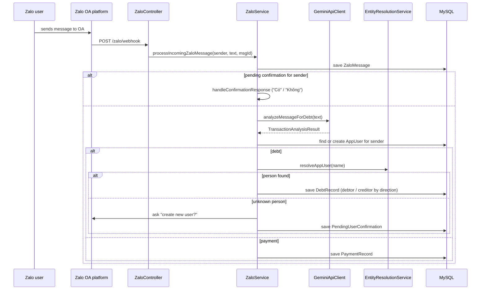

# zalobot

A Spring Boot backend for a **Zalo Official Account (OA) bot** that keeps track of
informal debts and payments between people, based on the chat messages users send
to the OA.

Users write messages like *"I owe Lan 50k for lunch"* to the OA. The bot stores
the message, analyses it for debt/payment information, works out who the other
person is (exact name, alias or fuzzy match) and records the transaction. If the
other person is unknown, the bot asks the sender whether a new person should be
created before recording anything.

> **Status: work in progress.** The pipeline (webhook, persistence, entity
> resolution, confirmation prompts, Zalo token handling, Gemini client) is in
> place, but the message classifier `GeminiApiClient#analyzeMessageForDebt` is
> currently a stub that returns an empty result, so incoming messages are not yet
> turned into debt/payment records. See [Known limitations](#known-limitations).

## Features

- **Zalo OA webhook** – receives user messages (`POST /zalo/webhook`) and answers
  the verification challenge (`GET /zalo/webhook`).
- **Message history** – every inbound message is stored in MySQL.
- **Debt / payment records** – a debt has a debtor, a creditor, amount, reason and
  date; the direction (`USER_OWES_OTHER` / `OTHER_OWES_USER`) decides who is who.
  Payments are stored per user.
- **Entity resolution** – the counterparty name is resolved by exact name, then by
  alias, then by fuzzy matching (FuzzyWuzzy ratio > 80).
- **Confirmation flow** – if no matching person exists, the bot replies on Zalo
  asking whether to create one (*Có/Không*) and parks the analysed transaction in
  `pending_user_confirmations` until the user answers.
- **Zalo OAuth v4** – exchanges the authorization code for access/refresh tokens
  (`GET /zalo/callback`), stores them, and refreshes the access token
  automatically when it expires.
- **Scheduled polling** – every 60 s the bot fetches the latest message of each
  configured user through the Zalo conversation API and processes it.
- **Gemini chat endpoint** – `POST /zalo/gemini/command` forwards free text to
  Gemini (`gemini-2.5-flash`) with per-sender in-memory conversation history.
- **Dev tools** – with the `dev` profile, `/simulate/message` injects a fake
  inbound message and `/simulate/clear-db` wipes the tables.

## Tech stack

| Area        | Technology                                                      |
|-------------|-----------------------------------------------------------------|
| Language    | Java 17                                                         |
| Framework   | Spring Boot 3.4.0 (Web, WebFlux `WebClient`, Data JPA, Validation, Actuator) |
| Build       | Gradle 8.14 (wrapper included)                                  |
| Database    | MySQL 8 (Hibernate, `ddl-auto=update`)                          |
| AI          | Google Gemini API (`generateContent`, `gemini-2.5-flash`)       |
| Messaging   | Zalo Official Account Open API v2.0, Zalo OAuth v4              |
| Libraries   | Gson, FuzzyWuzzy, Lombok                                        |
| Testing     | JUnit 5, Reactor `StepVerifier`, OkHttp `MockWebServer`          |

## Architecture



Outbound Zalo calls (`sendMessage`, `getConversation`, `getProfile`) go through
`getValidAccessToken()`, which loads the latest token from `zalo_tokens` and
refreshes it via OAuth v4 when it has expired.

### Data model

| Table                        | Purpose                                              |
|------------------------------|------------------------------------------------------|
| `app_users`                  | People known to the bot (name, optional Zalo ID)     |
| `user_aliases`               | Alternative names for an app user                    |
| `debt_records`               | Debtor, creditor, amount, reason, date               |
| `payment_records`            | Payments per user                                    |
| `pending_user_confirmations` | Transactions waiting for a "create user?" answer     |
| `zalo_messages`              | Inbound/outbound message log                         |
| `zalo_tokens`                | Zalo OAuth access/refresh tokens                     |

## Configuration

All credentials and environment-specific values come from environment variables
(see [`.env.example`](.env.example)). Nothing secret is committed.

| Variable                 | Required | Description                                                     |
|--------------------------|----------|-----------------------------------------------------------------|
| `ZALO_APP_ID`            | yes      | Zalo app ID (developers.zalo.me)                                |
| `ZALO_APP_SECRET`        | yes      | Zalo app secret key                                             |
| `ZALO_OA_ID`             | yes      | Zalo Official Account ID                                        |
| `ZALO_REDIRECT_URI`      | no       | OAuth callback URL (default `http://localhost:8081/zalo/callback`) |
| `ZALO_SCHEDULED_USERS`   | no       | Comma-separated Zalo user IDs polled every 60 s                 |
| `GEMINI_API_KEY`         | yes      | Google Gemini API key                                           |
| `GEMINI_API_URL`         | no       | Default `https://generativelanguage.googleapis.com`            |
| `DB_URL`                 | yes      | JDBC URL, e.g. `jdbc:mysql://localhost:3306/zalobot`            |
| `DB_USERNAME`            | yes      | Database user                                                   |
| `DB_PASSWORD`            | yes      | Database password                                               |
| `SERVER_PORT`            | no       | Default `8081`                                                  |
| `SPRING_PROFILES_ACTIVE` | no       | Default `local`; add `dev` to enable `/simulate/*`             |

Alternatively, copy
[`src/main/resources/application-local.properties.example`](src/main/resources/application-local.properties.example)
to `application-local.properties` (git-ignored); it is picked up by the default
`local` profile.

## Running locally

Prerequisites: JDK 17 and a MySQL 8 database.

```bash
# 1. Create a database
mysql -u root -p -e "CREATE DATABASE zalobot; CREATE USER 'zalobot'@'%' IDENTIFIED BY 'change-me'; GRANT ALL ON zalobot.* TO 'zalobot'@'%';"

# 2. Provide configuration (env vars, or application-local.properties as above)
export ZALO_APP_ID=... ZALO_APP_SECRET=... ZALO_OA_ID=... GEMINI_API_KEY=...
export DB_URL="jdbc:mysql://localhost:3306/zalobot" DB_USERNAME=zalobot DB_PASSWORD=change-me

# 3. Start the app (Windows: gradlew.bat bootRun)
./gradlew bootRun
```

Then:

1. Authorize the OA by opening the Zalo OAuth URL for your app with the redirect
   URI pointing to `/zalo/callback`; the bot stores the returned tokens.
2. Point the OA webhook to `https://<public-host>/zalo/webhook` (e.g. via a
   tunnel such as ngrok or cloudflared).

To try the flow without Zalo, run with `SPRING_PROFILES_ACTIVE=local,dev` and:

```bash
curl -X POST "http://localhost:8081/simulate/message" \
     --data-urlencode "senderId=test-user" \
     --data-urlencode "messageText=Tôi nợ Lan 50k tiền ăn trưa"
```

## Testing

```bash
./gradlew test      # or: ./gradlew build
```

Tests run without network access or real credentials: `GeminiApiClientTest`
uses OkHttp `MockWebServer` to stub the Gemini API (success, empty response,
HTTP error, and that the API key is sent as a header rather than in the URL).

## Project structure

```
src/main/java/io/github/baoloc1993/zalobot
├── ZalobotApplication.java
├── config/       ZaloConfig (OA settings), ZaloScheduler (60 s polling)
├── controller/   ZaloController (webhook, OAuth callback, OA API proxies),
│                 UserSimulationController (dev profile only)
├── model/        JPA entities, TransactionAnalysisResult,
│                 gemini/ (request/response DTOs), zalo/ (webhook DTO)
├── repository/   Spring Data JPA repositories
└── service/      ZaloService (message pipeline, Zalo API, tokens),
                  GeminiApiClient, EntityResolutionService,
                  ZaloTokenService, UserSimulationService
src/main/resources/application.properties
src/test/java/.../service/GeminiApiClientTest.java
```

## Known limitations

- `GeminiApiClient#analyzeMessageForDebt` is a placeholder; the prompt-based
  extraction still has to be wired in, so no records are created from real
  messages yet.
- New confirmations are stored with type `CREATE_APP_USER`, while incoming
  messages look up confirmations of type `PENDING`, so the *Có/Không* reply is
  not yet routed back to the pending transaction.
- Gemini chat history for `/zalo/gemini/command` is kept in memory only.
- The schema is managed by Hibernate `ddl-auto=update`; there are no migrations.
